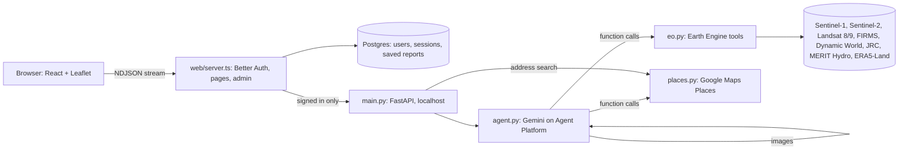

# Orra

**Like a vehicle history report, but for land.** Search for a home you plan to buy or rent (or drop a pin), say one sentence about your life, and a Gemini agent turns years of satellite imagery into a plain-language history of that ground: floods, heat, smoke, how the area has changed, and how far the daily needs are. The report leads with what needs your attention, so you don't have to read all of it. The same engine gives banks and insurers a one-page collateral risk summary and checks a flood claim's date against the radar record.

Built for the Google Cloud AI Builder Cup 2026, theme **BFSI: Intelligent Risk, Fraud & Financial Experiences**.

- **Live demo:** https://orra-599619212058.asia-southeast1.run.app (sign in with Google)
- **Video:** _link_

## Why

Listings show only the good side. Nobody tells a family that a street floods most years, or that smoke from field burning drifts in every dry season. In September 2024, floods after Typhoon Yagi swept through Mae Sai, Thailand. Satellite radar recorded the water, but nobody turned that record into a warning a homebuyer could read.

## What Gemini does

Gemini does more than summarise a dashboard. It has five jobs, and each one shows up live in the app's trace panel.

| # | Job | How |
|---|---|---|
| 1 | **Understand the person** | Free text such as "I have a baby and an old car, ground-floor unit", typed or spoken (recorded in the browser and transcribed by Gemini, Thai or English, into the same editable box), becomes a structured profile with risk weights (structured output). |
| 2 | **Plan the analysis** | A function-calling agent decides which satellite tools to call and in what order. If the radar record shows floods, it fetches the images of the worst event. If burning is heavy or smoke matters to this person, it widens the fire search. |
| 3 | **Read the images** | Gemini looks at the radar and Sentinel-2 before/after chips and says what changed and where, relative to the pin (multimodal). |
| 4 | **Weigh and decide** | It combines the evidence with the profile into Low / Medium / High chapters and a 3-line verdict. Compare mode ranks two places for this specific person. |
| 5 | **Answer follow-ups** | "Is the smoke only in March?" is answered from the stored evidence. When needed it calls the tools again, and it says "not enough evidence" when satellites can't answer. |

### Guardrails

- **Evidence rule, enforced in code:** every claim in the report names the tool that produced it. `enforce_evidence()` drops any claim whose tool never ran, and a chapter left without evidence becomes "Not enough evidence". The trace shows each removal.
- **Honest gaps:** missing data comes back as `null` plus a note, never 0, so clouds or a missing radar pass become "not enough evidence" instead of a guess.
- **No false precision:** levels are Low / Medium / High with reasons, not made-up probabilities.
- **Decision support, not advice:** the report is not an appraisal or engineering survey.
- **Verifiable reports:** the server saves every report as it streams and gives it a link (`/r/<id>`, Google sign-in). The browser never writes one, so a printed lender brief can be checked against the original.
- **Claim checks are templated, not written:** the flood claim verdict is a fixed sentence chosen from the measured facts (water at the pin, water within 300 m, no pass), so the same facts always read the same. It only says "review the claim" for open ground with a pass within a day of the date: on built-up ground (usually radar-bright) or with a later pass, it says radar can neither confirm nor rule out a flood.

## Architecture



- One Cloud Run service, two processes. The analysis is stateless: the browser holds the report and posts it back for compare, chat and the lender view. Postgres holds accounts and a copy of each finished report, which the Node server saves from the stream (`lines.ts`) so links and printouts can be verified.
- Each signed-in person gets 20 Earth Engine checks (reports and claim checks) a day; staff (verified Google accounts on `STAFF_DOMAIN`) are exempt. Request bodies are capped at 1 MB.
- `web/` is the Vite + React + TypeScript app (`src/`) and the Node server in front of everything (`server.ts`). Google sign-in uses Better Auth (`auth.ts`). `/api/*` passes through to FastAPI only for signed-in users, so strangers can't spend Earth Engine or Gemini quota.
- `/admin` lists, bans, signs out and deletes users, and shows platform counts. It opens only for staff, and the server checks that rule on every admin call.
- `eo.py` holds the Earth Engine evidence tools. Each returns facts, the exact dataset and date range used, and PNG chips.
- `agent.py` holds the Gemini work: intake, the tool loop (manual function calling so every step streams), image reading, the judge step, compare and chat.
- `places.py` calls Places API (New) as the service account (no API key): address search, the nearest shops, hospital, school and transit for chapter 05, and a search for any named place or brand near the pin ("where's the nearest Big C?") that the agent calls from chat, with distances computed in code. It also pulls the last 30 days of PM2.5 from the Air Quality API for the smoke chapter. Neither is cached, per the Google Maps Platform terms.
- `main.py` serves the streaming routes (report, compare, chat, translate, claim, places) and the tile proxy, on localhost only.
- `cache/` stores tool results for sites already run (the test pins in `pins.json` included), so a repeat is instant and survives an Earth Engine outage.

## Evidence chapters

| Chapter | Question | Data |
|---|---|---|
| Water | Has water reached this ground, how often, how recently? | Sentinel-1 radar from 2018, change detection against the usual backscatter for that orbit and month. JRC Global Surface Water masks permanent water. MERIT Hydro gives height above nearest drainage. |
| Heat | Is it hotter than the surrounding area? | Landsat 8/9 land surface temperature, March–May composites. |
| Smoke and fire | Are there burn hotspots nearby in the dry season, and upwind? How has the air been lately? | NASA FIRMS active fire (MODIS) plus ERA5-Land dry-season wind; Google Air Quality API PM2.5 for the last 30 days, as daily means against Thailand's 24-hour standard (37.5 µg/m³). |
| Change around you | What has been built, cleared or flooded nearby since 2017? | Dynamic World land cover plus Sentinel-2 before/after chips (Cloud Score+ masked), read by Gemini. |
| Daily needs nearby | How far are shops, a hospital, a school and transit? | Google Maps Places (New) Nearby Search within 10 km; straight-line distance, not travel time. |

**Flood claim check** (lender view): an insurer enters a claimed flood date, and Orra takes the Sentinel-1 pass nearest that date (within 6 days), measures water at the pin and within 300 m against the usual radar for that orbit and month, and shows both images with Gemini's reading. Chat can do the same for any date ("was it flooded on 12 September 2024?").

Every dataset is global, so the same engine works for Jakarta, Manila, Ho Chi Minh City or Dhaka without new data.

## Run it

You need a Google Cloud project with Earth Engine registered and the Vertex AI (Agent Platform) and Places API (New) (`places.googleapis.com`) and Air Quality (`airquality.googleapis.com`) APIs enabled, plus application default credentials.

```bash
uv venv && uv pip install -r requirements.txt
export GOOGLE_CLOUD_PROJECT=<project> GOOGLE_CLOUD_LOCATION=global
.venv/bin/uvicorn main:app --reload        # API on :8000
.venv/bin/python agent.py                  # offline guardrail self-check
.venv/bin/python places.py                 # offline distance and PM2.5 self-check
.venv/bin/python eo.py                     # Earth Engine self-check on the test pins
.venv/bin/python agent.py warm             # run the full agent on every test pin in English and Thai, filling cache/
```

The web app needs Node 22.18+ (it runs `server.ts` directly), a Postgres database and a Google OAuth client (APIs & Services → Credentials → OAuth client ID → Web application). Its redirect URI is `<BETTER_AUTH_URL>/api/auth/callback/google`. Add these to `.env`:

```bash
DATABASE_URL=postgresql://orra:<password>@127.0.0.1:5434/orra   # Cloud SQL via the proxy below
BETTER_AUTH_SECRET=<openssl rand -base64 32>
BETTER_AUTH_URL=http://localhost:5173       # the URL people open; in production, the Cloud Run URL
GOOGLE_CLIENT_ID=<oauth client id>
GOOGLE_CLIENT_SECRET=<oauth client secret>
STAFF_DOMAIN=example.org                   # verified Google accounts on this domain get /admin and no daily cap; unset: nobody
```

```bash
cloud-sql-proxy <project>:<region>:<instance> --port 5434 &   # keep running while you work
cd web && npm install
npm run migrate                            # once, and after Better Auth upgrades: creates its tables and `report`
npm run server                             # auth + pass-through to :8000, on :3000
npm run dev                                # http://localhost:5173 (proxies /api to :3000)
npm test && npm run build                  # staff rule and stream tests; type check + production build
```

Same container Cloud Run runs (Podman or Docker; `--network=host` only if the container can't resolve DNS, which also means you need port 8000 free on the host):

```bash
podman build --network=host -t orra .
podman run --rm -p 8080:8080 --env-file .env -e BETTER_AUTH_URL=http://localhost:8080 \
  -e GOOGLE_APPLICATION_CREDENTIALS=/creds.json \
  -v ~/.config/gcloud/application_default_credentials.json:/creds.json:ro orra   # http://localhost:8080
```

Deploy to Cloud Run. You need a Cloud SQL Postgres instance, a runtime service account, an Artifact Registry repo `orra`, and Secret Manager secrets `database-url`, `better-auth-secret` and `google-client-secret`. The image build runs `npm test` and `python agent.py`, so a failing self-check stops the deploy.

```bash
.venv/bin/python agent.py warm             # optional: fill cache/ first; it ships in the image, so test pins are instant
P=<project>; R=<region>; IMG=$R-docker.pkg.dev/$P/orra/orra:$(date +%Y%m%d-%H%M)
gcloud auth print-access-token | podman login -u oauth2accesstoken --password-stdin $R-docker.pkg.dev
podman build --network=host -t $IMG . && podman push $IMG
gcloud run deploy orra --image $IMG --project $P --region $R   # later deploys: env vars, secrets and Cloud SQL carry over
```

The first deploy also needs `--service-account <runtime account> --add-cloudsql-instances $P:$R:<instance> --memory 1Gi --timeout 900 --max-instances 3 --no-invoker-iam-check` (public; the app's own sign-in guards `/api`), the env vars `GOOGLE_CLOUD_PROJECT`, `GOOGLE_CLOUD_LOCATION`, `GEMINI_MODEL` (optional), `BETTER_AUTH_URL=<service URL>`, `GOOGLE_CLIENT_ID` and `STAFF_DOMAIN`, and `--set-secrets` for `DATABASE_URL`, `BETTER_AUTH_SECRET` and `GOOGLE_CLIENT_SECRET`. `database-url` uses the Cloud SQL socket: `postgresql://orra:<password>@/orra?host=/cloudsql/$P:$R:<instance>`.

The runtime account needs `roles/aiplatform.user`, `roles/earthengine.writer`, `roles/serviceusage.serviceUsageConsumer`, `roles/cloudsql.client`, and read access to those three secrets. Add `<service URL>/api/auth/callback/google` to the OAuth client's redirect URIs.

## Limits

- Radar sees water poorly between buildings, so flood shares describe flood-prone ground within 1 km and the pin itself is reported separately.
- Satellites revisit every 6–12 days, so a flood peak can fall between passes. The report states the pass date it actually used.
- Surface temperature is not air temperature, and MODIS fire pixels are 1 km.
- Nearby distances are straight-line, and Places sometimes types a clinic as a hospital or a tutoring centre as a school.
- Air quality covers only the last 30 days (all the API keeps) and is Google's modelled estimate, not a monitor at the house; the fire record covers the dry seasons.

## Data and attribution

Contains modified Copernicus Sentinel data (2017–2026). Places data © Google (Google Maps). Includes air quality data from Google. Landsat imagery courtesy of the U.S. Geological Survey. NASA FIRMS (LANCE). Dynamic World (Google and World Resources Institute). JRC Global Surface Water (Pekel et al., 2016). MERIT Hydro (Yamazaki et al., 2019). ERA5-Land (Copernicus Climate Change Service). Cloud Score+ (Google). Map imagery © Esri, Maxar, Earthstar Geographics.

Orra is decision support from public satellite data. It is not a formal appraisal, valuation or engineering survey.
